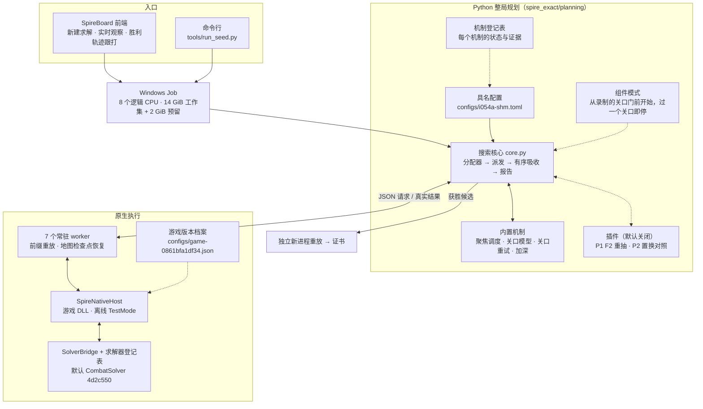

# SpireExact — i100-r

**给定一个 Slay the Spire 2 种子，在预算内搜索一条能从开局完整重放的通关路线。** SpireExact 把地图、选牌、商店、火堆和战斗接成一次整局搜索：从已经执行过的动作前缀出发不断尝试新的延续，找到胜利后在独立的新进程里从开局逐动作重放，确认后生成证书。研究设置为 IRONCLAD / Ascension 10 / all unlocks / fresh start / mode1 全信息，允许利用种子决定的未来。

**i100-r · 0.5.0** 取代 i100 成为公开默认版本。它的搜索行为就是 i054a（共享内存版 i054a-shm）：这是目前唯一在真实游戏新种子上做过配对检验的配置。代码换成了重构后的核心：搜索主循环、机制、插件、具名配置、组件模式、游戏版本档案和求解器登记表各自独立。不开插件时，重构核心与 i054a-shm 逐请求一致。

**建议每个种子用 60 分钟预算。**

[构建与运行](docs/BUILD.md) · [架构说明](docs/ARCHITECTURE.md) · [前端说明](dashboard/README.md) · [版本说明](release/i100r/RELEASE_NOTES.md) · [原生验收记录](release/i100r/NATIVE_ACCEPTANCE.json)

## 真实游戏结果

两组结果都来自真实游戏 DLL（离线 TestMode），每次胜利都经过独立新进程的完整重放确认。

| 检验 | 配置 | 种子 | 结果 |
| --- | --- | --- | --- |
| holdout-01（iteration-055） | frozen-i054a，每次 30 分钟 | 20 个新种子 × 1 次 | **17 / 20** 获胜（85%，Wilson 95% 区间 64–95%） |
| iteration-105 A 臂 | frozen-i054a-shm，每次 60 分钟 | 40 个新种子 × 2 个 solver seed | 30 分钟内 **65 / 80** 次获胜，60 分钟内 **70 / 80** 次；60 分钟内 **37 / 40** 个种子至少胜一次 |

iteration-105 同时跑了 i101b（在 i054a 之后加入多项新机制的候选）作对照：同一种子上 i101b 的求解用时是 i054a-shm 的 **1.23 倍**（几何均值比，95% 区间 1.05–1.46，双侧 p = 0.005，38 个非平局种子中 29 个更慢）。i100 公开版的评估来自合成战役世界，没有做过同样的真实游戏配对检验，所以 i100-r 回到 i054a 的搜索行为。上面这 60 个种子之后都用于开发。

## i100-r 与 i054a-shm 一致

| 检查 | 结果 |
| --- | --- |
| 从本仓库源码新编译的宿主，对 iteration-105 的 14 个录制请求重新执行 | **14 / 14** 决策完全相同（宿主 `f15c023e…`，参照宿主 `4c899200…`） |
| 通过 SpireBoard 前端提交 3 分钟求解（种子 1102482246） | 前 **116 / 116** 次评估的动作、观测和战斗节点数与 iteration-105 原记录完全相同 |
| 命令行入口 `tools/run_seed.py` 跑 2 分钟 | 正常结束，退出码 0 |
| 四个 .NET 项目构建 | 0 warning / 0 error |
| 配置、插件、组件模式、版本兼容和前端的离线测试 | 72 项通过；1 项需要研究用门库，跳过 |

详细记录见 [NATIVE_ACCEPTANCE.json](release/i100r/NATIVE_ACCEPTANCE.json) 和 `release/i100r/ENGINEERING_*.json`。

## 架构



- **搜索核心**只有一个循环：分配器把空闲 worker 填满，评估层派发并按序收回结果，每个结果先做核心记账，再依次交给各个机制，最后发布报告。循环本身不含任何机制。
- **机制登记表**记录每个机制的状态和证据。默认配置启用的 8 项机制（聚焦调度、关口模型先验、escalate 关口计划、关口重试、最终幕 open 计划、根策略、聚焦簇上限、战斗 advisor）登记为 `validated-as-i054a`；共享 worker 内存、事件驱动结算、有序派发 3 项登记为 `infra`，按逐请求一致验收。新机制以**插件**形式接入，只能通过五个挂点（请求修补、提案、请求来源、关口模型、根策略表）影响搜索，状态是 `experimental`，默认配置不能启用 `experimental` 机制（测试强制检查）。
- **具名配置**把 iteration-105 A 臂的完整参数写成 `configs/i054a-shm.toml`，命令行每个参数都归类为运行身份、预算资源或某个机制的选项。
- **组件模式**从门库里录制的关口门前状态开始搜索，过了指定关口（A1、A2、F1、F2）就停，用来以分钟级成本比较关口层面的机制。它只用于研究，不产生整局结果。
- **求解器登记表**让一个宿主按请求加载不同的 CombatSolver 构建；**游戏版本档案**把与某个游戏版本绑定的输入（反射 API、RNG 流、未存档状态路由表、可用求解器）集中到一个文件，游戏更新时 `python -m spire_exact.game_profile check` 列出需要重新生成的项目。

完整说明见 [docs/ARCHITECTURE.md](docs/ARCHITECTURE.md)。

## 快速开始

需要 Windows x64、**Python 3.12+**、.NET 9 SDK、Git，以及你自己安装的 STS2 **v0.111.0** 和完整的 RitsuLib Workshop item **3747602295**。

```powershell
# 1. 准备依赖并构建（首次需要联网获取固定版本的 CombatSolver 和 NuGet 包）
python tools/setup_source.py `
  --game-dir "<你的游戏根目录或 data_sts2_windows_x86_64 目录>" `
  --ritsu-dir "<你的 Workshop/3747602295 目录>"
python tools/setup_source.py --check-only

# 2. 建立本机求解快照 experiments/frozen-i100r
python tools/prepare_local_entry.py --artifact-root "<存放运行输出的目录>"

# 3. 启动 SpireBoard
powershell -NoProfile -File dashboard/start.ps1 -PythonExe python -Port 8765
```

浏览器打开 [http://127.0.0.1:8765/](http://127.0.0.1:8765/)，点 **新建求解**，输入种子、选时间上限（默认 60 分钟，可选 1–180 分钟）后提交。页面实时显示搜索进展、资源占用和关口模型；找到并验证胜利后，**胜利轨迹** 页可以按步骤在真实游戏里跟打。

命令行启动单种子作业：

```powershell
python tools/run_seed.py --seed 101 --minutes 60 `
  --iteration my-runs --name seed-101 --workspace experiments/frozen-i100r --detach `
  --extra --root-policies pick,elo --focus-cluster-cap 2 --final-gate-plan open --worker-memory-policy shared
```

`result.json` 中 `VERIFIED_WIN_IN_NATIVE_HOST` 表示候选已通过独立原生重放；`UNKNOWN` 表示预算内没有找到胜利，不代表种子无解。构建细节、命令行参数和故障处理见 [docs/BUILD.md](docs/BUILD.md)。

## 源码导航

| 路径 | 内容 |
| --- | --- |
| `spire_exact/planning/core.py` | 搜索核心：分配器、派发、吸收、报告 |
| `spire_exact/planning/mechanisms.py` | i054a 的内置机制 |
| `spire_exact/planning/plugins/` | 插件挂点与 P1、P2 两个实验插件 |
| `spire_exact/planning/registry.py` | 机制登记表与参数分类 |
| `spire_exact/planning/configs.py`、`configs/` | 具名配置、求解器登记表、游戏版本档案 |
| `spire_exact/planning/component.py` | 组件模式 |
| `spire_exact/solvers.py`、`spire_exact/game_profile.py` | 求解器登记与游戏版本档案 |
| `native/SpireNativeHost/` | C# 原生宿主、战斗 advisor、SolverBridge |
| `tools/setup_source.py` | 依赖准备、构建和身份检查 |
| `tools/prepare_local_entry.py` | 建立前端使用的本机快照 |
| `tools/run_seed.py` | 单种子作业启动器 |
| `tools/speed_calibration.py`、`tools/replay_golden.py` | 录制请求对拍与逐请求等价检查 |
| `tools/fork_check.py`、`tools/route_check.py` | 检查点分叉保真检查 |
| `dashboard/` | SpireBoard 前端 |
| `release/i100r/` | 本版本的身份、构建、验收与研究证据 |

## 发行内容与许可

仓库只包含源码、配置、测试、文档和精选证据。游戏与 Workshop DLL、.NET SDK、第三方检出、构建产物和运行输出由用户在本机准备，不在仓库中；仓库也不含任何反编译的游戏源码。项目采用 [MIT 许可证](LICENSE)，上游与社区数据来源（包括 CombatSolver 与 Random Foreseer）见 [THIRD_PARTY_NOTICES.md](THIRD_PARTY_NOTICES.md)，固定的 CombatSolver 提交见 [upstream.lock.json](upstream.lock.json)。

历史版本：[i082 Beta](https://github.com/Luminesce4you/SpireExact/releases/tag/v0.3.1-beta.1-i082) · [holdout-01](https://github.com/Luminesce4you/SpireExact/releases/tag/v0.3.0-holdout-01) · i100 源码保留在 [`i100-release`](https://github.com/Luminesce4you/SpireExact/tree/i100-release) 分支。
