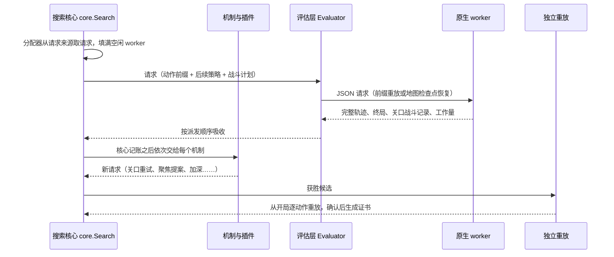

# i100-r 架构

i100-r 的搜索行为与 i054a-shm 相同。重构做了两件事：一是把 i054a 原来写在一个大函数里的搜索拆成可单独检查的部分，二是给以后的新机制、新求解器和新游戏版本各留出固定的接入点。本页按一次求解的路径说明各部分。

## 1. 三层

| 层 | 位置 | 职责 |
| --- | --- | --- |
| Python 整局规划 | `spire_exact/planning/` | 动作前缀档案、调度、关口模型、请求派发与结果吸收、运行报告 |
| C# 原生宿主 | `native/SpireNativeHost/` | 用游戏 DLL 在离线 TestMode 中创建、恢复和推进游戏状态，执行菜单与战斗动作，导出证据和二进制身份 |
| CombatSolver | 固定提交，setup 时获取 | 战斗束搜索，为整局 rollout 提供战斗计划 |

规则全部由用户安装的游戏程序集执行，规划器里没有手写的卡牌、遗物或事件效果。

## 2. 一次求解



1. **分配器**按固定顺序询问请求来源：紧急队列、失败修复队列、插件来源、战略调度器（聚焦或加权）、从开局重启。
2. **评估层**构造请求、派发给 worker、按派发顺序收回结果，管理结果缓存、地图边界检查点和评估账本。有序吸收让同样的输入产生同样的请求序列，这是逐请求对拍的基础。
3. **吸收**先更新档案、前缀树、关口模型等核心状态，再按顺序调用各机制。机制观察结果，把新请求排进紧急队列或修复队列；下一步跑什么由分配器决定，机制不改动循环。在 i054a 配置下实际产生评估的机制只有关口重试。
4. **胜利验证**：获胜候选在新进程里从开局完整重放，不使用 advisor、检查点或缓存，观察到原生胜利才生成证书。

搜索循环本身不含任何机制。i054a 的机制在 `mechanisms.py`，调度器在 `focus.py`、`indexed_strategy.py`。

## 3. 机制登记表与具名配置

`registry.py` 登记每个机制的状态和证据：

| 状态 | 含义 | 机制 |
| --- | --- | --- |
| `validated-as-i054a` | i054a 默认配置的一部分，作为整体通过 holdout-01 | 聚焦调度、关口模型先验、escalate 关口计划、关口重试、最终幕 open 计划、根策略（pick / elo）、聚焦簇上限、战斗 advisor |
| `infra` | 只影响速度或资源，按逐请求一致验收 | 共享 worker 内存、事件驱动结算、有序派发 |
| `experimental` | 已实现，还没有真实游戏配对证据 | focus-carry、关口探针、求解器版本切换、束宽覆盖等，以及全部插件 |
| `retired` | 测过没有保留，或已被替代 | 旧调度器、战斗探针修复、根组合等 |

默认配置 `configs/i054a-shm.toml` 只能启用前两类，测试会检查这一点。命令行的每个参数都必须登记为运行身份、预算资源或某个机制的选项，新增参数忘记登记时测试失败。

具名配置用 `--config NAME` 展开成命令行参数，写在后面的参数可以覆盖其中的单项。`i054a-shm.toml` 与 iteration-105 A 臂的启动参数逐项相同。

## 4. 插件

新机制以插件形式接入（`spire_exact/planning/plugins/`），只能使用五个挂点：

| 挂点 | 作用 |
| --- | --- |
| 请求修补 | 派发前修改请求 |
| 提案 | 观察每个真实结果，排入新请求 |
| 请求来源 | 给分配器增加来源，可以占一定份额 |
| 关口模型 | 换用关口模型的子类 |
| 根策略表 | 登记新的根策略选牌表 |

用 `--plugin NAME[:key=value,...]` 或配置里的 `[plugins.NAME]` 选用。当前两个插件都是 `experimental`，默认关闭：

- **P1 `p1-f2-reroll`（F2 重抽）**：轨迹输在最终幕第二个首领时，从 F1 入口重解 F1，换用宿主预测会赢、但没有选用的其他战斗计划。F2 的抽牌依赖 F1 怎么打，所以换一种赢法就是一次新的 F2 尝试。需要宿主在构建戳里声明对应能力，否则拒绝启动。
- **P2 `p2-permuted-predictor`**：用打乱目标拟合的关口模型，作为关口模型的空白对照。

不开插件时，搜索与 frozen-i054a-shm 逐请求一致（`tools/replay_golden.py` 检查）。

## 5. 组件模式

`component.py` 让整局搜索从门库里录制的关口门前状态开始：

- 门前的动作前缀固定为诊断范围，搜索不会改动它；
- 请求在关口所在层之后的第一个地图决策处停下；
- 第一次活着通过目标关口（A1、A2、F1、F2）时结束；在战斗中的门前反复重启只会重放同一场战斗，所以连续 2 × worker 数次重启都重复已见轨迹、且没有排队的修复时，以 `component_exhausted` 结束。

组件模式用来以分钟级成本比较关口层面的机制，结果是“过一个关口用了多少时间和评估”，不是整局结果。门库由 `tools/codex_gate_library.py` 从录制的运行生成，本仓库不附带。用法：`python -m spire_exact.planning --config i054a-shm --component <门库条目 ID> --gate-library <门库 sqlite> --out <新目录>`。

## 6. 求解器登记表与游戏版本档案

**求解器登记表**（`configs/solvers.json`、`spire_exact/solvers.py`）：宿主不在编译期依赖 CombatSolver，`BeamAdvisor.cs` 按每个请求里的路径加载 solver 和 harness，所以换求解器版本只需加一条登记，不需要第二份宿主。默认条目 `cs-4d2c550` 生成的请求字节与引入登记表之前完全相同，缓存和证书不受影响。`cs-0.50.1` 只有登记信息，依赖没有随包提供。

**游戏版本档案**（`configs/game-<sts2.dll 前 12 位>.json`、`spire_exact/game_profile.py`）集中记录与一个游戏版本绑定的输入：宿主反射的 API 摘要、RunRngType 随机流、未存档状态路由表、通过契约检查的求解器构建和 Workshop 依赖目录。

```powershell
python -m spire_exact.game_profile check    # 已安装的游戏与档案对比，列出需要重新生成的项目
python -m spire_exact.game_profile create   # 为已安装的游戏写档案（不覆盖已有文件）
```

## 7. 等价与保真检查

| 工具 | 检查 |
| --- | --- |
| `tools/speed_calibration.py --other-host` | 新宿主对录制请求的决策是否逐个相同 |
| `tools/replay_golden.py` | 整个搜索的请求序列和最终报告是否与录制一致 |
| `tools/fork_check.py` | 从检查点分叉的状态与从开局重放的状态是否一致；差异按 `configs/unsaved-state.json` 分类 |
| `tools/route_check.py` | 批量检查录制路线上各个门前的分叉保真 |

## 8. 证据范围

- 执行环境是离线 TestMode 下的游戏 DLL；没有声明与正常 Godot 游戏逐帧等价。
- `UNKNOWN` 只表示预算内没有找到胜利，不是种子无解的证明。
- 关口模型、探针和组件结果只用于分配算力，不进入胜利证据。
